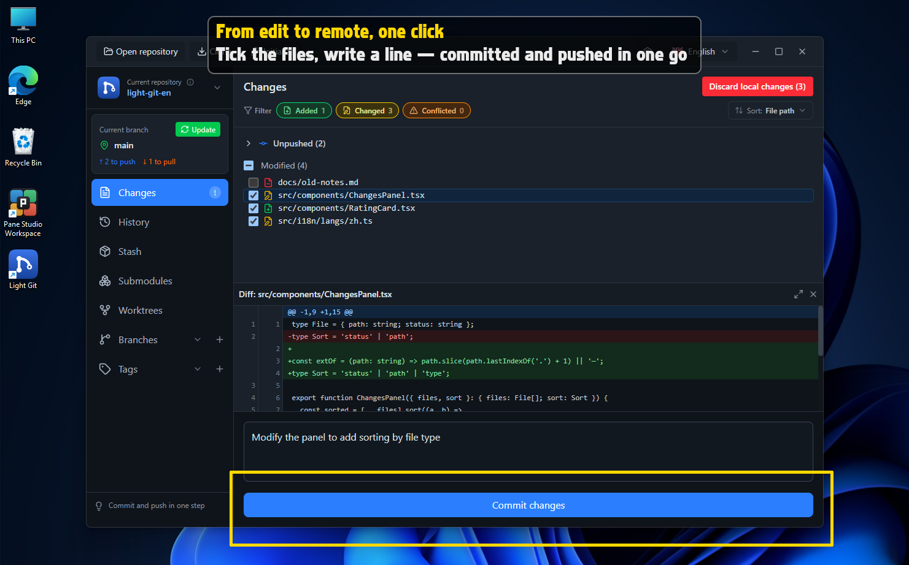
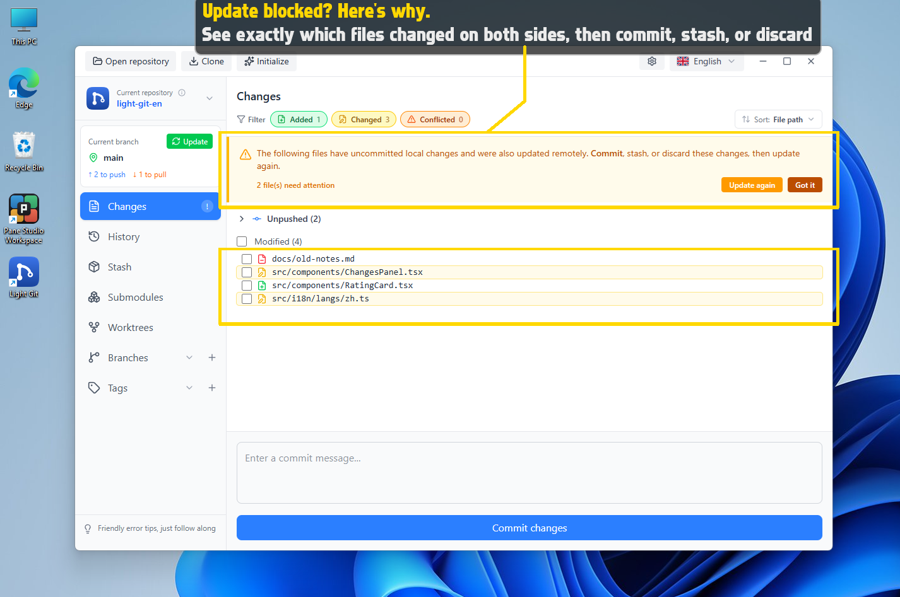

# Light Git

**A Windows Git GUI for people who don't need to master Git — the operations that usually go wrong are kept out of your way.**

It focuses on **the few minutes when things have already gone wrong**: an update rejected, a colleague's changes lost while resolving a conflict, a branch you created that nobody can pull, or a commit you thought you pushed but never did. Light Git turns those moments into screens you can read, click and finish — that's where the Git barrier comes down.

[Get Light Git on Microsoft Store](https://apps.microsoft.com/detail/9phbd1zbmf88?hl=en-US)

---

## Why it exists

Committing, pushing and switching branches — any Git client can do that. What actually stops people is something else, and it's always the same problem: you see an error but don't know which way out is open.

Most tools stop halfway — they throw the raw error at you, in technical wording, without saying what to click next. Light Git puts the problem on the table first, then narrows the way out to two or three buttons.

## Four stuck moments, and how each one ends

| # | Situation | The usual outcome | Light Git |
| :-: | --- | --- | --- |
| 01 | After an update or merge, the Staged list fills with files you never wrote; a quick Restore wipes your colleagues' commits | You can't tell what's yours and what came in from others, and nothing stops a "restore everything" | The Staged list is **read-only during a conflict**, with nowhere for Restore / Discard to act — a colleague's commit can't be deleted by accident |
| 02 | An update fails with a single message and you don't know what to do next; work stops there | A bare `error` plus two filenames, with no hint of what went wrong or what to do first | Before updating, it lists **every file changed on both sides** with the reason, and offers three ways out: commit / stash / discard, each with its consequence spelled out |
| 03 | A new branch only exists locally; a colleague can't pull it and the two copies drift apart | Creating a branch is a local action; the remote needs a separate push | Creating a branch **also pushes it**; if the remote refuses, the local branch is rolled back — never a branch only you can see |
| 04 | A local commit succeeds and you assume you're done; your colleague still gets the old code | Commit and push are two buttons and two states, with nothing flagging the missing step | Commit and push are **one action**, with a permanent `↑ 2 to push` badge in the sidebar; a failed push explains why and points to the next step |

Here's what #02 looks like:

## How Light Git avoids those mistakes

Other tools warn you. Light Git removes the entry point: it removes the states themselves, or merges them into one action — so the cases below aren't "unlikely", they **don't exist**:

- **No "losing a colleague's changes while resolving a conflict"** — the Staged list is read-only, with nowhere for Restore / Discard to act; there's no way to casually delete the files your colleague already committed.
- **No "committed, but never pushed"** — commit and push are one action, with no second button to forget.
- **No "forgot to add it to the staging area"** — there is no staging area in the interface; tick a file and it's in this commit, untick it and it isn't.
- **No "resolved the conflict, forgot to mark it"** — resolution depends only on whether conflict markers (`<<<<<<<`) remain in the file, not on a button being clicked.
- **No "force-pushing when a push fails"** — when the remote has new commits, it updates first and then pushes, so a colleague's commit can't be overwritten.
- **No "shows modified, opens up empty"** — files made stale by line endings rewritten through Unity / Cocos are detected and cleaned automatically and no longer appear in Changes; real edits and staged content are untouched.

## The rest of the time

| Area | What you can do |
| --- | --- |
| Changes | Grouped by added / modified / deleted; only ticked files go into this commit. Line-by-line diffs, before/after for images, cell-by-cell diffs for spreadsheets (.xlsx / .xls / .csv) that also detect whole-row and whole-column insert/delete; sort by status, path or type, filter by added / changed / conflict; commit messages can be generated from the change statistics |
| History | Branch lanes; press Ctrl+F or click the magnifier to search by commit message with highlighted hits and Enter to step through; a counter under the box shows the search scope and hit position. Open a commit for its file list and line-by-line diff (spreadsheets compare cell by cell too); expand the diff to fill the content area or step through files and hunks; copy the hash; create a branch or tag right there |
| Branches | Local and remote in one list, with the same switch / merge / delete workflow; merge prefers the latest remote commit; creating a branch also pushes it, and a failed push rolls the local ref back |
| Remotes | Add, edit and delete multiple remotes in Repository Properties and choose which one updates and pushes; the last remaining one cannot be deleted |
| Tags | Add a message to create an annotated tag and push it; locate it in History; deleting removes local and remote together |
| Stashes | Restore and Apply are separate; untracked files can be included; if a restore is blocked, stash the current work first and retry |
| Submodules | Lists path, remote URL, current branch and uncommitted changes; uninitialized ones can be initialized in one click; initialized ones open as standalone repositories; can be created, have their URL changed or be deleted (the deletion is committed on the Changes page) |
| Worktrees | Several folders checked out from one repository at once; the path can be left empty to generate it, an existing branch is checked out as-is, a missing one is created from the current commit and pushed; can be opened and deleted; the main and current worktrees cannot be deleted |
| Repository | Clone directly from a remote URL; checking out a specific commit requires a target branch, so you never land on a detached HEAD |
| Environment | Git is detected at startup; a missing Git gets a one-click install, or you can point to an existing `git.exe` |
| Interface | Light and dark themes follow Windows; Simplified Chinese, Traditional Chinese, English, Japanese, German, Spanish and French |

## What it doesn't do

Half of the "doesn't exist" cases above come from removing features. The removed parts, spelled out:

- No interactive history rewriting (`rebase -i`, squash, editing already-pushed commits)
- No force push
- Not a hosting, pull-request or issue-tracking tool
- No CI, no pipelines
- No cross-repository bulk operations

These aren't omissions, they're trade-offs: every such feature adds another button that can break a project, and in those few minutes people are most likely to follow a button blindly. If you need full history rewriting or force push, Fork / Sourcetree / GitHub Desktop are better fits; submodules and worktrees keep only the everyday parts: submodules can be viewed, initialized, added, have their URL changed and be deleted; worktrees can be viewed, created, opened and deleted. On the same project, experienced teammates using those tools and newcomers using Light Git don't get in each other's way.

## Who it's for

It has nothing to do with project size. On any team, not everyone is fluent in Git — preventing one accident is cheaper than a post-mortem:

- Teams where not everyone writes code: planners, ops, designers and QA also deliver files to the same repository
- People new to Git, or who got burned once and don't quite trust it
- Anyone onboarding newcomers and wanting "what to do before committing" to be a few fixed buttons
- Experienced users who don't want to memorize commands but expect every commit to be clean
- Small projects missing the SVN feeling of "change it, commit it"

## Download

- **Windows 10 / 11 (64-bit)** — free · no ads · no in-app purchases · no account needed · your code stays on your computer; installer about 4.5 MB:
  [⬇️ Download Light Git](https://raw.githubusercontent.com/xlan8/paneStudioRelease/refs/heads/main/lightGit/PaneStudioWorkspace_1.0.4_overseas_x64-setup.zip)
- Or get it from the [Microsoft Store](https://apps.microsoft.com/detail/9phbd1zbmf88?hl=en-US) — the Store build is updated by the Store, the website build has a built-in updater; features are identical.
- Install takes about 10 seconds. If Windows shows a blue warning (common for unsigned new apps), click **More info → Run anyway**.
- UI languages follow the system: Simplified Chinese, Traditional Chinese, English, Japanese, German, Spanish, French.

## 30-second quick start

1. **Open a repository** — select an existing one, or clone directly from a remote URL; if Git is missing, the app can install it.
2. **Tick, write a message, commit** — only the files you ticked go into this commit; one click commits and pushes.
3. **If something goes wrong, follow the prompt** — a rejected update lists the overlapping files, conflicts are resolved hunk by hunk, and new branches are pushed automatically.

## FAQ

- **Do I need Git installed first?** — Light Git detects Git at startup and guides you through a one-click install if it's missing.
- **Will my code be uploaded to your servers?** — No. Code only travels between your computer and the remotes you configure; there's no server and no account (see the [privacy policy](privacy.html)).
- **Can I only connect to GitHub?** — Any Git repository: GitHub, Gitee, GitLab, your own server, a local bare repo.
- **How is it different from GitHub Desktop / Sourcetree / Fork?** — They aim for completeness, on the assumption that you already know what Git is doing; Light Git narrows the scope and focuses on safer, clearer operations, at the cost of interactive history rewriting and force push. Submodules and worktrees keep the everyday actions: view, initialize / create, open and delete. For different stages of Git experience.
- **Will it silently discard my changes?** — No. Discarding changes, deleting branches and aborting merges all ask for confirmation; there's no force push; nothing rewrites your repository in the background.
- **Using Unity / Cocos — files always show as modified but the diff is empty?** — The engine rewrites line endings when saving assets, so the content didn't actually change. Those fake changes are cleaned automatically and no longer appear in Changes; real edits are untouched.
- **Is it free?** — Free, no ads, no in-app purchases, no sign-up.

## Application info

| Item | Detail |
| --- | --- |
| Application | Light Git |
| Version | 1.0.4 |
| Size | About 4.5 MB (installer) |
| Category | Developer tools → Version control client |
| License | Free |
| Supported OS | Windows 10 / 11 (64-bit) |
| UI languages | Simplified Chinese, Traditional Chinese, English, Japanese, German, Spanish, French |
| Dependency | Git command-line tool (one-click install in the app; only needed for remote operations) |
| Installer | `PaneStudioWorkspace_1.0.4_overseas_x64-setup.exe` |

## Contact

Questions, feedback and bug reports: **w13683434020@gmail.com**

---

© 2026 Light Git. For Windows 10 / 11 (64-bit) · [Privacy policy](privacy.html)
